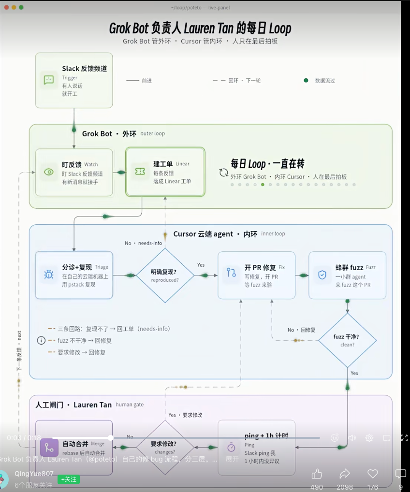

# EvoPilot Runtime · v0.10.0 Preview

English | [简体中文](README_CN.md)

This source tree documents the Runtime 0.10.0 Preview target. Live provider, Codex Desktop and browser acceptance require evidence bound to the exact source and package. The [v0.10.0 Release page](https://github.com/yeliang-wang/evopilot-runtime/releases/tag/v0.10.0) is the intended location for downloads after a separately approved publication.

Runtime is an independent lifecycle service. It owns project definitions, goals, targets, instances, execution gates, receipts and audit. The Runtime Expert in Codex uses Streamable HTTP MCP for project configuration and readback. The feedback loop delegates coding to Cursor Cloud.

[Feedback-loop guide](docs/runtime-v010-preview.md) · [Documentation](docs/README.md) · [Fixed acceptance](governance/acceptance-v010.json)

## From feedback to PR merge

1. Configure an isolated project through the Runtime Expert. Use `/lifecycle` to edit the flow graph and YAML, validate the configuration and save a draft. The named owner reviews and activates the exact candidate separately.
2. Runtime routes authorized feedback into a Linear issue. When more information is needed, a reply resumes the original issue and instance. Cursor Cloud reproduces the defect and prepares or revises the same GitHub PR. Independent verification evaluates the exact PR head and base.
3. An acknowledged review notification starts a 60-minute window. A valid veto blocks that head. After the deadline, Runtime rechecks the candidate, evidence, project preauthorization and channel coverage before requesting a protected GitHub rebase merge. Confirmed GitHub readback is required before closure. Use `/monitor` to inspect the current node, visited path, actual return edges and review deadline.

Slack Socket Mode is the first platform adapter. Live Slack end-to-end acceptance is deferred because a test channel is unavailable. The representative journey calls for an authenticated callback channel and actual Linear, Cursor Cloud and GitHub services.



*User-supplied external workflow screenshot showing Grok Bot, Slack, Linear and Cursor. The capture shows the QingYue807 video overlay. The original video post is unidentified. Runtime uses Codex for configuration and readback, then handles intake, orchestration and recovery through its own service. The image illustrates the external example. Runtime Dashboard acceptance uses separate browser captures.* [Source diagram](https://github.com/ythx-101/live-panel-skill/blob/main/examples/loop-poteto/preview-light.webp) · [Upstream notices](https://github.com/ythx-101/live-panel-skill/blob/main/NOTICE) · [Lauren Tan’s original workflow post](https://x.com/poteto/status/2107510472601985336)

## Quickstart

### Install a release tarball

After publication, use **Node 24.14.0 on macOS arm64** and obtain all six assets from the owning Release: `evopilot-runtime-0.10.0-darwin-arm64.tar.gz`, `evopilot-next-runtime-0.10.0.tgz`, `distribution-manifest.json`, `runtime-dependency-lock.json`, `source-revision.txt` and `SHA256SUMS`. In a new private download directory:

```sh
shasum -a 256 -c SHA256SUMS
cat source-revision.txt
mkdir unpacked
tar -xzf evopilot-runtime-0.10.0-darwin-arm64.tar.gz -C unpacked
chmod 600 distribution-manifest.json
```

The standalone archive contains its runtime dependencies. GitHub Releases is the distribution channel. Check the published manifest and approved profile before preparing an isolated protected installation plan. For the feedback-loop prerequisites and the distinction between package, service and Host evidence, see the [operator guide](docs/runtime-v010-preview.md).

### Develop from source

Use the locked TypeScript 5.9.3 toolchain:

```sh
npm ci --ignore-scripts
npm run build
npm run check
npm test
```

Source tests are isolated technical evidence. They do not replace the fixed acceptance, real Host journeys, publication or installed verification. Candidate distribution preparation runs only from clean committed source.

## Content levels and trust

Retained `readiness.*` APIs use `standardVersion: "v2"`: L1 is domain understanding, L2 implementation specification and L3 reconstruction specification completeness. `assetAssessment` and `reconstructionVerification` are independent; `L3 / NOT_REQUESTED` is valid. It does not prove generated functional equivalence or grant release authority. See the [v2 API](docs/readiness-v2.md).

Secrets stay in protected references, outside YAML and ordinary logs. Service-managed operations enforce scope, authority and exact evidence; Runtime does not control unrelated work performed outside its managed paths. The local trust boundary assumes a non-malicious OS user. Preview does not establish GA or production deployment support. Historical records and the [v0.8.3 documentation](https://github.com/yeliang-wang/evopilot-runtime/blob/v0.8.3/README.md) retain their original meaning.

## Documentation and contribution

- [EvoPilot](https://github.com/yeliang-wang/evopilot/blob/main/README.md) for stack navigation, [Harness](https://github.com/yeliang-wang/evopilot-harness/blob/main/README.md) for validation assets and evidence evaluation, and [Ontology](https://github.com/yeliang-wang/evopilot-ontology/blob/main/README.md) for semantic assets.
- [v0.9 operator guide](docs/runtime-v090.md) and [Lifecycle API](docs/lifecycle-api.md).
- [Documentation index](docs/README.md), [CLI](docs/cli.md), [planning](docs/planning-api.md) and [readable API](docs/readable-api.md).
- [Recorded token usage](docs/token-usage-v090.md): explicit Codex sources, Base-stage snapshots and version reports; statistics do not gate execution.
- [Compatibility and migration](docs/legacy-host.md), [feedback](docs/feedback.md) and [reviewed response](docs/response.md).
- [Changelog](CHANGELOG.md), [Roadmap](docs/roadmap.md), [contributing](CONTRIBUTING.md) and [bilingual maintenance](docs/documentation-languages.md).
- [Security](SECURITY.md), [Apache-2.0 license](LICENSE), [notices](NOTICE) and [provenance](provenance/).
