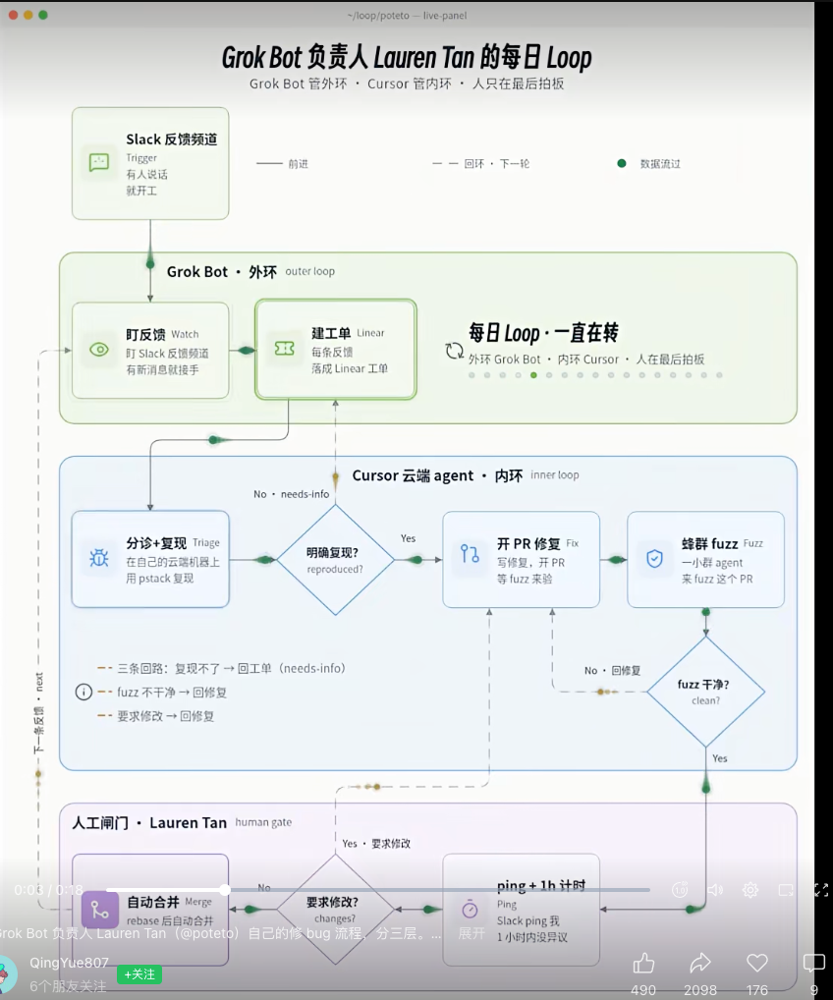

# EvoPilot Runtime · v0.10.0 Preview

[English](README.md) | 简体中文

本源码树说明 Runtime 0.10.0 Preview 的交付目标。真实 Provider、Codex Desktop 和浏览器的验收须使用绑定到准确源码与制品的证据。另行批准并发布后，下载文件将列在 [v0.10.0 Release 页面](https://github.com/yeliang-wang/evopilot-runtime/releases/tag/v0.10.0)。

Runtime 是独立生命周期服务，管理项目定义、目标、Target、实例、执行门禁、回执和审计。Codex 中的 Runtime Expert 通过 Streamable HTTP MCP 配置项目并读回状态。反馈闭环由 Cursor Cloud 执行编码。

[反馈闭环使用指南](docs/zh-CN/runtime-v010-preview.md) · [中文文档](docs/zh-CN/README.md) · [固定验收清单](governance/acceptance-v010.json)

## 从反馈到 PR 合并

1. 通过 Runtime Expert 配置隔离项目。在 `/lifecycle` 编辑流程图和 YAML、校验配置并保存草稿。由指定项目负责人另行审阅和启用准确候选。
2. Runtime 将授权反馈转成 Linear 工单。需要补充信息时，回复继续原工单和实例。Cursor Cloud 复现问题，并创建或修订同一个 GitHub PR。独立验证针对准确的 PR head 和 base 执行。
3. 审阅通知确认送达后，开启 60 分钟窗口。有效否决会阻止该 PR head 合并。到期后，Runtime 重新核验候选、证据、项目预授权和审阅渠道覆盖情况，再发起受 GitHub 分支保护约束的 rebase 合并。结案前须读回 GitHub 的合并结果。打开 `/monitor` 可查看当前节点、已走路径、实际回退边和审阅截止时间。

Slack Socket Mode 是首个平台适配器。由于没有测试频道，真实 Slack 端到端验收已延期。代表性验收流程使用经过身份验证的回调通道，并连接真实 Linear、Cursor Cloud 和 GitHub 服务。



*用户提供的外部工作流截图，展示 Grok Bot、Slack、Linear 与 Cursor。截图保留 QingYue807 的视频叠层，原视频帖子的链接尚待确认。Runtime 通过 Codex 配置并读回状态，由自身服务承担接单、编排与恢复。本图仅用于说明外部示例，Runtime Dashboard 使用单独的浏览器截图验收。* [原始图表](https://github.com/ythx-101/live-panel-skill/blob/main/examples/loop-poteto/preview-light.webp) · [上游声明](https://github.com/ythx-101/live-panel-skill/blob/main/NOTICE) · [Lauren Tan 的工作流原帖](https://x.com/poteto/status/2107510472601985336)

## 快速开始

### 安装发行包

发布后，使用 **macOS arm64 和 Node 24.14.0**，从本组件 Release 获取全部六份制品：`evopilot-runtime-0.10.0-darwin-arm64.tar.gz`、`evopilot-next-runtime-0.10.0.tgz`、`distribution-manifest.json`、`runtime-dependency-lock.json`、`source-revision.txt` 和 `SHA256SUMS`。在新的私有下载目录执行：

```sh
shasum -a 256 -c SHA256SUMS
cat source-revision.txt
mkdir unpacked
tar -xzf evopilot-runtime-0.10.0-darwin-arm64.tar.gz -C unpacked
chmod 600 distribution-manifest.json
```

独立归档包含运行依赖。制品通过 GitHub Releases 发行。准备受保护的隔离安装计划前，核对发布清单和获批的发行范围。反馈闭环的前置条件及制品、服务与 Host 证据的区别，见[使用指南](docs/zh-CN/runtime-v010-preview.md)。

### 从源码开发

使用锁定的 TypeScript 5.9.3 工具链：

```sh
npm ci --ignore-scripts
npm run build
npm run check
npm test
```

源码测试属于隔离技术证据，不能替代固定验收、真实 Host 流程、发布及安装验证。候选制品准备只使用已提交且无修改的源码。

## 内容等级与信任

保留的 `readiness.*` API 使用 `standardVersion: "v2"`：L1 为领域理解，L2 为实现规格，L3 为重建规格内容完备。`assetAssessment` 和 `reconstructionVerification` 独立，`L3 / NOT_REQUESTED` 有效，不证明生成软件功能等价，也不授予发布权限。参阅 [v2 API（英文）](docs/readiness-v2.md)。

秘密保存在受保护引用中，不进入 YAML 或普通日志。服务管理的操作校验范围、权限和精确证据；Runtime 不控制用户在纳管路径之外执行的无关操作。本机信任边界假定 OS 用户非恶意。Preview 不代表 GA 或生产部署支持。历史记录和 [v0.8.3 文档](https://github.com/yeliang-wang/evopilot-runtime/blob/v0.8.3/README_CN.md)保持原义。

## 文档与贡献

- [EvoPilot](https://github.com/yeliang-wang/evopilot/blob/main/README_CN.md) 提供组件导航，[Harness](https://github.com/yeliang-wang/evopilot-harness/blob/main/README_CN.md) 管理验证资产与证据评定，[Ontology](https://github.com/yeliang-wang/evopilot-ontology/blob/main/README_CN.md) 管理语义资产。
- [v0.9 使用指南](docs/zh-CN/runtime-v090.md)与[生命周期 API（英文）](docs/lifecycle-api.md)。
- [中文文档入口](docs/zh-CN/README.md)、[CLI（英文）](docs/cli.md)、[规划（英文）](docs/planning-api.md)和[可读 API（英文）](docs/readable-api.md)。
- [已记录 Token 消耗](docs/zh-CN/token-usage-v090.md)：明确的 Codex 来源、Base 阶段快照和版本报告；统计不作为执行门禁。
- [兼容与迁移（英文）](docs/legacy-host.md)、[反馈（英文）](docs/feedback.md)和[经审阅响应（英文）](docs/response.md)。
- [更新记录](CHANGELOG.md)、[Roadmap](docs/roadmap.md)、[贡献指南](CONTRIBUTING.md)和[双语维护](docs/zh-CN/documentation-languages.md)。
- [安全](SECURITY.md)、[Apache-2.0 许可证](LICENSE)、[声明](NOTICE)和[来源](provenance/)。
